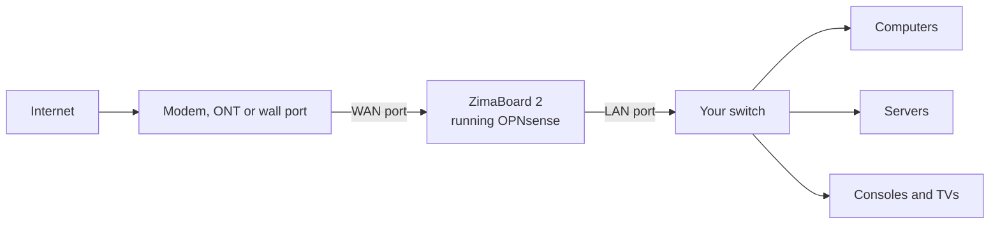

# ZimaBoard 2 OPNsense Firewall

Turn a ZimaBoard 2 into your own router and firewall with [OPNsense](https://opnsense.org/), starting from the moment you open the box.

> **Status: draft.** These steps follow the official OPNsense and Zima documentation. Step 1 has been checked on a ZimaBoard 2 832 with firmware built 22 July 2025; steps 2 to 5 have not yet been run on real hardware. This notice will be replaced with the exact versions tested once they have been.

## What you end up with

- A dedicated firewall that blocks every unsolicited connection from the internet by default.
- DHCP and DNS for your home network, with fixed addresses for the devices that need them.
- A web dashboard showing traffic, connected devices and logs.
- Your old router kept untouched on the shelf, so going back takes one cable swap.

The ZimaBoard 2 has two 2.5GbE ports, which is exactly one WAN and one LAN. Add-ons such as DNS filtering, a VPN gateway and VLANs come later (see [`addons/`](addons/)).

## Before you start

| You need | Notes |
|---|---|
| ZimaBoard 2 (832 or 1664) | Either model works. 8 GB of RAM is plenty for this build |
| What came in the box | Power adapter and SATA Y-cable (checked in step 1) |
| 2.5-inch SATA SSD, 120 GB or larger | OPNsense goes here, so the factory ZimaOS stays on the eMMC as a fallback |
| USB flash drive, 8 GB or larger | For the installer. A second one is handy for configuration backups |
| USB keyboard and an HDMI or DisplayPort screen | Mini DisplayPort to HDMI adapter if your screen has no DisplayPort |
| Two or three Ethernet cables | Cat5e or better carries 2.5GbE |
| A computer to prepare the USB drive | Windows, macOS or Linux |
| Your current router | Used for the test run, then kept as your way back |

Plan for about two hours for steps 1 to 3, and a quiet hour for the switchover in step 4, when your home's internet will drop for a few minutes.

## Steps

1. [Unboxing and hardware](docs/01-unboxing-and-hardware.md): check the box, tour the ports, fit the SSD and open the firmware setup.
2. [Installing OPNsense](docs/02-install.md): download and check the installer, write the USB drive, install to the SSD.
3. [First configuration](docs/03-first-configuration.md): assign the ports, run the setup wizard, update, back up.
4. [Switching over from your old router](docs/04-cutover.md): test behind your current router, then take its place, with a rollback plan.
5. [Verification](docs/05-verification.md): a checklist that proves it all works.

Stuck? See [troubleshooting](docs/troubleshooting.md).

## Ground rules this guide follows

- **Nothing on the WAN side is opened.** No port forwards, no web interface on the WAN, no UPnP unless you choose to add it later.
- **Never plug a fresh board straight into the internet.** Its first boot happens behind your existing router, so nothing on it is reachable from outside before it is configured.
- **Your old router is your rollback.** Leave its settings alone until the new firewall has run cleanly for a while.
- **Configuration backups are private.** An OPNsense backup file contains password hashes and keys. Keep it off GitHub, cloud shares and screenshots.

## Disclosure

The ZimaBoard 2 and accessories used for this guide were provided free by Zima (IceWhale).

## Sources

- [OPNsense: Get started](https://opnsense.org/get-started/)
- [OPNsense manual: Initial installation and configuration](https://docs.opnsense.org/manual/install.html)
- [OPNsense 26.7 release notes](https://docs.opnsense.org/releases/CE_26.7.html)
- [ZimaBoard 2 product page](https://shop.zimaspace.com/products/zimaboard2-single-board-server)
