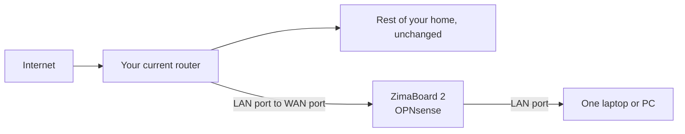

# 3. First configuration

This step sets OPNsense up **on the bench**: the ZimaBoard sits behind your current router, and only one computer sits behind the ZimaBoard. The rest of your home keeps using the old router and notices nothing.



You need: two Ethernet cables, and a laptop or PC you can unplug from your normal network for an hour.

## 3.1 Check for an address clash first

OPNsense uses `192.168.1.1/24` on its LAN by default. Many routers use the same range. If yours does, OPNsense would see the same network on both sides and traffic would not flow.

Find your current router's range on any computer connected to it:

- **Windows:** `ipconfig` and look at *Default Gateway*
- **macOS:** `route -n get default | grep gateway`
- **Linux:** `ip route | grep default`

If the gateway starts with `192.168.1.`, give OPNsense a different LAN range for the bench test before going further:

1. At the OPNsense console, choose **2) Set interface IP address**, then the LAN interface.
2. Answer **no** to configuring it by DHCP.
3. Enter an unused private address, for example `10.99.99.1`, with subnet bit count `24`.
4. Press Enter for no upstream gateway, and answer no to the IPv6 questions.
5. Answer **yes** to enabling the DHCP server, and give a range such as `10.99.99.100` to `10.99.99.200`.
6. Keep HTTPS for the web interface.

Wherever this guide says `192.168.1.1` below, use your bench address instead.

## 3.2 Assign WAN and LAN

The two ports look identical, so let OPNsense tell you which is which.

1. Plug one end of an Ethernet cable into a **free LAN port on your current router**. Leave the other end loose for now.
2. At the OPNsense console, choose **1) Assign interfaces**.
3. Answer **no** to configuring LAGGs and **no** to VLANs.
4. At *Enter the WAN interface name or 'a' for auto-detection*, type `a`, then plug the loose cable end into the ZimaBoard port you want as WAN. OPNsense detects the link (for example `igc0`).
5. For LAN, type `a` again, then connect your laptop to the **other** ZimaBoard port.
6. Press Enter to skip optional interfaces, and confirm with `y`.

If auto-detection gives you trouble, type the names directly. There are only two, `igc0` and `igc1`.

**Label the ports now.** A piece of tape marked WAN and LAN saves you from the most common mistake in this whole build: swapped cables.

## 3.3 Log in to the web interface

1. On the laptop, turn **Wi-Fi off** so all its traffic goes through the ZimaBoard. Make sure its wired connection is set to get an address automatically.
2. It should receive an address such as `192.168.1.100`.
3. Open **https://192.168.1.1** in a browser.
4. The browser warns about the certificate. That is expected: OPNsense made its own certificate during the install. Continue to the page.
5. Log in as `root` with the password you set during the install.

## 3.4 Run the setup wizard

The wizard opens on first login. If it doesn't, find it under **System → Wizard**. Field names shift a little between releases; these are the choices that matter:

| Setting | Choose | Why |
|---|---|---|
| Hostname | e.g. `firewall` | Any short name you'll recognise |
| Domain | `home.arpa` | Reserved for home networks ([RFC 8375](https://www.rfc-editor.org/rfc/rfc8375)), so it never clashes with a real domain |
| DNS servers | Leave empty | OPNsense's built-in resolver (Unbound) looks names up itself |
| Time zone | Yours | Log timestamps make sense |
| WAN type | **DHCP** | Your current router (and later your modem or wall port) hands out the address |
| Block private networks (WAN) | **Off for the bench test** | The bench WAN gets a private address from your current router. Revisit this in step 4 |
| Block bogon networks (WAN) | **On** | Drops traffic from address ranges that should never appear on the internet |
| LAN address | Keep `192.168.1.1/24` (or your bench range) | Step 4 decides the final range |
| Root password | Leave as set | You chose it during the install |

Apply the settings at the end and wait for the page to reload. If the wizard doesn't show the two WAN blocking options, they are under **Interfaces → WAN**.

## 3.5 Check the internet works through the firewall

On the laptop:

- Open a few websites.
- Check that names resolve through OPNsense:

  ```bash
  nslookup example.com 192.168.1.1
  ```

- In the OPNsense web interface, **Interfaces → Overview** should show an address on WAN, and the **Dashboard** should show the gateway as online.

If websites don't load, see [troubleshooting](troubleshooting.md#no-internet-behind-the-firewall).

## 3.6 Update OPNsense

1. **System → Firmware → Status → Check for updates.**
2. Install what it offers. Reboot when asked.
3. Check again until no more updates are offered.

From the console, **12) Update from console** does the same.

## 3.7 A few safe defaults

- **Add no rules on WAN.** Under **Firewall → Rules → WAN** there should be nothing you created. With no pass rules, every unsolicited connection from outside is dropped. That is the whole point.
- **Leave SSH off** unless you need it (**System → Settings → Administration**). If you turn it on later, allow keys only, not passwords, and only on LAN.
- **Don't install UPnP yet.** Some games and remote-access tools like it, but it lets devices open ports on their own. [Troubleshooting](troubleshooting.md#game-console-shows-a-strict-nat-type) covers safer options if you need one.

## 3.8 Back up the configuration

1. **System → Configuration → Backups.**
2. Tick the option to **encrypt** the file and choose a password, then **Download configuration**.
3. Keep the file somewhere private: a USB drive in a drawer, or an attachment in your password manager.

The backup contains password hashes and private keys. **Never** commit it to Git, upload it to a public place, or show it on screen. This repository's `.gitignore` refuses common backup file names as a safety net.

Take a fresh backup before every significant change from here on.

## Done when

- The laptop reaches the internet through the ZimaBoard.
- OPNsense is fully updated.
- You have an encrypted configuration backup stored somewhere private.
- The ports are labelled WAN and LAN.

Next: [4. Switching over from your old router](04-cutover.md)
