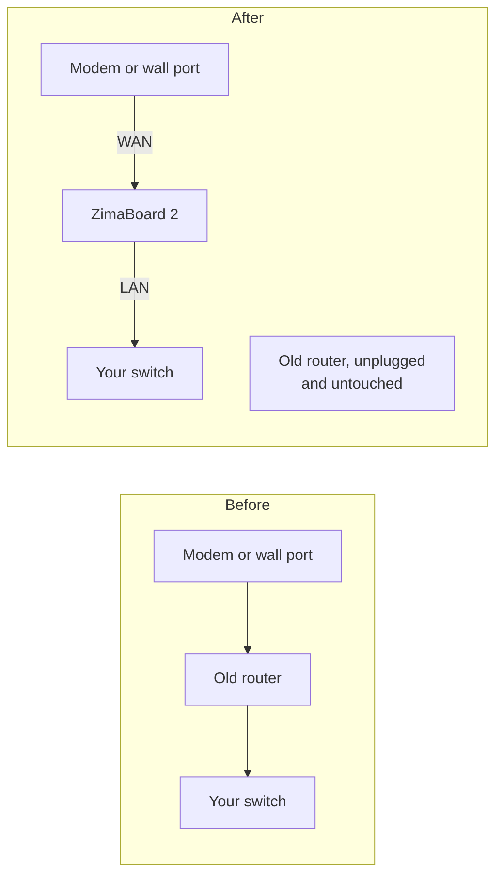

# 4. Switching over from your old router

The ZimaBoard now works on the bench. This step moves it into your old router's place, so that it faces the internet and serves the whole home.

The goal is a switchover your devices barely notice: same network range, same gateway address, same fixed addresses. Your old router stays exactly as it is, so going back is one cable swap.

## 4.1 Decide on your network range

**Option A: keep your old router's range (recommended).** OPNsense takes over the old router's LAN address, DHCP range and fixed addresses. Devices keep their addresses, and anything that reaches another device by IP address keeps working.

**Option B: start a fresh range.** Cleaner if you want to renumber anyway, but every fixed address, bookmark and hand-configured device has to change at the same time.

The rest of this page assumes option A.

## 4.2 Write down what your old router does today

Log in to your old router and record the following in **private** notes. These details describe your home network; they don't belong in a public repository, a screenshot or a video.

- [ ] Its **LAN address and subnet** (the gateway your devices use), for example `192.168.X.1/24`
- [ ] Its **DHCP range** and **lease time**
- [ ] Every **DHCP reservation**: device name, MAC address, IP address
- [ ] Every device whose address is **set by hand on the device itself**
- [ ] **Port forwards**, **DMZ** and **port triggering** entries. Ideally there are none. Each one is a door into your network, so decide whether you still need it
- [ ] Whether **UPnP** is on, and which devices use it (consoles and remote-access tools often do)
- [ ] Whether it also provides your **Wi-Fi**

Also:

- [ ] Export the old router's configuration to a file, and keep it private.
- [ ] Run a **speed test** from a wired computer and note the result, so you can compare afterwards.
- [ ] Take a fresh OPNsense backup (**System → Configuration → Backups**).

## 4.3 Pick a quiet time and get ready

Your internet drops for a few minutes during the swap. Have ready:

- the ZimaBoard's screen and keyboard, still connected
- the laptop from step 3
- a phone with mobile data, in case you need to look something up

## 4.4 Give OPNsense its final LAN settings

1. **Unplug the ZimaBoard's WAN cable** from the old router. The bench test is over, and the next change would otherwise put the same network range on both sides.
2. At the OPNsense console, choose **2) Set interface IP address**, then the LAN interface:
   - Answer **no** to DHCP for the interface itself.
   - Enter your **old router's LAN address** and subnet bit count (usually `24`).
   - Press Enter for no upstream gateway, and answer no to the IPv6 questions unless you use IPv6.
   - Answer **yes** to the DHCP server, and enter your **old router's DHCP range**.
   - Keep HTTPS.
3. Unplug and replug the laptop's cable so it picks up an address in the new range.
4. Open the web interface at the new address, for example `https://192.168.X.1`.
5. Recreate each **DHCP reservation**: **Services → Dnsmasq DNS & DHCP → Hosts**, then add the host name, IP address and hardware (MAC) address from your notes. Apply.
6. Check **Services → Dnsmasq DNS & DHCP → DHCP ranges** shows the range you entered.
7. Take another configuration backup.

(Fresh OPNsense installs use Dnsmasq for DHCP. If your install uses ISC or Kea DHCP instead, the reservations live under that service's page.)

## 4.5 Swap the cables

1. Unplug the cable that runs from your **modem or wall port** to the old router's WAN port. Plug it into the ZimaBoard's **WAN** port.
2. Move the cable that runs from the old router's **LAN** port to your main switch onto the ZimaBoard's **LAN** port.
3. The ZimaBoard has only one LAN port. If devices were plugged straight into the old router, connect them to your switch instead. Everything must hang off one switch, or switches chained from it.
4. **Power off the old router** and set it aside with its settings untouched. Never connect it to your network while it is switched on: two DHCP servers on one network hand out conflicting addresses.

## 4.6 Bring it up

1. In the web interface, watch **Interfaces → Overview**. WAN should get an address within a minute or two.
2. If it doesn't, power-cycle your modem. Some modems remember the previous router's hardware address for a while. If your internet provider registers devices by hardware address, register the ZimaBoard with them.
3. Devices mostly carry on by themselves, because the gateway address hasn't changed. To speed things up, reconnect or restart them. Devices with reservations return to their usual addresses as they renew.
4. Look at your WAN address. If it is a **public** address (not starting `10.`, `172.16.` to `172.31.`, `192.168.`, or `100.64.` to `100.127.`), go to **Interfaces → WAN** and turn **Block private networks** back on. If your WAN still sits behind another router, leave it off.

## 4.7 What changes for the things you run

- **Port forwards:** OPNsense has none. If you really need one, add it deliberately later under **Firewall → NAT → Destination NAT**, and understand what it exposes first.
- **UPnP:** OPNsense doesn't run it by default. Peer-to-peer VPN tools (Tailscale, ZeroTier and similar) usually still connect but may fall back to slower relays, and game consoles may report a stricter NAT type. See [troubleshooting](troubleshooting.md).
- **Wi-Fi:** if your old router provided it, it leaves with the router. Add a dedicated access point on your LAN. Converting the old router to an access point also works, but only once you no longer need it as your rollback.

## 4.8 If something goes wrong: roll back

1. Move the modem/wall-port cable back to the old router's WAN port.
2. Move the switch cable back to the old router's LAN port.
3. Power the old router on.

Because the old router was never changed, your network returns to exactly how it was. Devices pick it up as they renew their addresses; restart any that don't.

Keep the old router untouched for at least a week or two after a successful switchover.

## Done when

- Every device is online, the ones with reservations at their usual addresses.
- The old router is off, unchanged, and within reach.
- You have run the checks in step 5.

Next: [5. Verification](05-verification.md)
